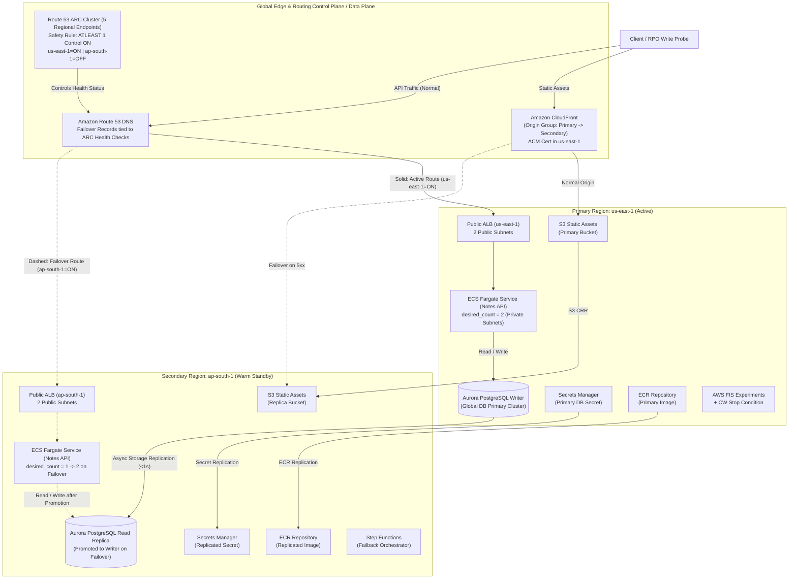

# System Architecture Specification (`ARCHITECTURE.md`)

**Sources of Truth:** [PRD.md](file:///c:/Users/arif3/OneDrive/Attachments/Desktop/MultiRegioHighAvalabilityUsingAWS/PRD.md), [DESIGN.md](file:///c:/Users/arif3/OneDrive/Attachments/Desktop/MultiRegioHighAvalabilityUsingAWS/DESIGN.md)  
**Primary Region:** `us-east-1` (Active) | **Secondary Region:** `ap-south-1` (Warm Standby)

---

## 1. High-Level Multi-Region Architecture

> **Diagram Legend:**  
> - **Solid Arrows (`--->`)**: Normal Operation Path (Active reads/writes in `us-east-1`, asynchronous physical storage/object/secret/image replication to `ap-south-1`).  
> - **Dashed Arrows (`-.->`)**: Failover Operation Path (Activated when Route 53 ARC switches `ap-south-1` to `ON` and `ap-south-1` Aurora Replica is promoted to Writer).



---

## 2. Layer-by-Layer Architecture & Design Rationale

### 2.1 Traffic Routing: Why Route 53 ARC Over Plain Route 53 Health Checks?
- **The Control-Plane Trap:** Standard Route 53 Health Checks and configuration updates rely on the Route 53 control plane, which is hosted in `us-east-1`. If `us-east-1` experiences a severe control-plane outage, modifying DNS records or health check configurations can stall.
- **The ARC Solution:** Route 53 Application Recovery Controller (ARC) provides **5 globally distributed data-plane cluster endpoints** across distinct AWS regions (`us-east-1`, `us-west-2`, `eu-west-1`, `ap-northeast-1`, `ap-southeast-2`). Toggling a routing control (`UpdateRoutingControlStates`) is a strongly consistent data-plane operation using the Raft consensus protocol across those 5 endpoints, bypassing the control plane completely.
- **Safety Rules:** ARC natively enforces an Assertion Rule (`ATLEAST 1 ON`), preventing operator error or automation bugs from turning off both regions simultaneously.

### 2.2 Compute Layer: Why ECS Fargate (Warm Standby `2` vs `1`)?
- **Why Fargate over EC2/EKS:** No EC2 AMI patching, no EKS control-plane tax ($0.10/hr per cluster × 2 regions = $144/mo baseline), and fast task scaling.
- **Why Warm Standby (`desired_count = 1` in `ap-south-1`) over Pilot Light (`desired_count = 0`):**
  - If `desired_count = 0` in DR, failover must wait for Fargate to provision an ENI, pull the image from ECR, pass container startup, and register with the ALB Target Group (+60 to +120 seconds added to RTO, plus risk of cold-start failure).
  - Running `desired_count = 1` (`0.25 vCPU`, `0.5 GB RAM`) in `ap-south-1` costs only **~$9/month** (~$0.012/hr) while guaranteeing that the network path, ALB target registration, Secrets Manager injection, and DB connection pool are verified 24/7 before an outage ever happens.

### 2.3 Database Layer: Why Aurora Global Database (PostgreSQL)?
- **Storage-Level Replication:** Unlike standard RDS cross-region read replicas (which stream logical WAL over the DB engine CPU), Aurora Global Database replicates directly from the distributed storage layer in `us-east-1` to the storage layer in `ap-south-1` with minimal performance impact on the primary writer.
- **Fast Promotion:** Detaching and promoting the `ap-south-1` secondary cluster to a standalone read/write cluster typically completes in **60 to 120 seconds**, regardless of database size.

### 2.4 Frontend & Static Assets: S3 CRR + CloudFront Origin Group
- Static assets (a lightweight status UI + metadata JSON) are uploaded to the primary S3 bucket in `us-east-1` and replicated automatically to `ap-south-1` via **S3 Cross-Region Replication (CRR)**.
- CloudFront is configured with an **Origin Group** using Origin Access Control (OAC). If the primary S3 origin returns `500, 502, 503, or 504`, CloudFront transparently fails over the GET request to the `ap-south-1` S3 bucket at the edge.

---

## 3. Regional VPC, Subnet & NAT Design

Both regions deploy from the exact same `modules/network` Terraform module with distinct CIDR blocks so VPC Peering or Transit Gateway could be added in the future without IP overlap:

| Parameter | Primary Region (`us-east-1`) | Secondary Region (`ap-south-1`) |
| :--- | :--- | :--- |
| **VPC CIDR** | `10.10.0.0/16` | `10.20.0.0/16` |
| **Availability Zones** | 2 AZs (`us-east-1a`, `us-east-1b`) | 2 AZs (`ap-south-1a`, `ap-south-1b`) |
| **Public Subnets (ALB & NAT)** | `10.10.1.0/24`, `10.10.2.0/24` | `10.20.1.0/24`, `10.20.2.0/24` |
| **Private App Subnets (ECS Fargate)** | `10.10.11.0/24`, `10.10.12.0/24` | `10.20.11.0/24`, `10.20.12.0/24` |
| **Isolated DB Subnets (Aurora)** | `10.10.21.0/24`, `10.10.22.0/24` | `10.20.21.0/24`, `10.20.22.0/24` |
| **NAT Strategy (`D2 Approved`)** | **1 NAT Gateway** in Public Subnet 1 (`single_nat_gateway = true`) | **1 NAT Gateway** in Public Subnet 1 (`single_nat_gateway = true`) |

**NAT Cost Impact Analysis:**
- Using `single_nat_gateway = true` per region keeps ECS tasks in private subnets (needed to pull ECR images, Secrets Manager secrets, and emit CloudWatch logs without exposing public IPs on tasks) while halving NAT hourly charges from 4 NAT Gateways ($0.18/hr) to 2 NAT Gateways ($0.09/hr).
- For production hardening, setting `single_nat_gateway = false` in `.tfvars` immediately provisions 1 NAT Gateway per AZ for full AZ independence.

---

## 4. Data Flow in Normal vs. Failover States

### 4.1 Normal State (`us-east-1 = ON`, `ap-south-1 = OFF`)
1. Client resolves API endpoint -> Route 53 returns `us-east-1` ALB IP because `rc-primary-us-east-1` health check is `Healthy`.
2. `us-east-1` ALB forwards request to one of `2` Fargate tasks in `us-east-1`.
3. Fargate task reads/writes to Aurora Primary cluster endpoint in `us-east-1` and returns HTTP 200 with header `X-Served-By-Region: us-east-1`.
4. Aurora storage asynchronously replicates blocks to `ap-south-1` (~180–400 ms lag).
5. In `ap-south-1`, `1` warm standby Fargate task responds `200 OK` on `GET /health` (liveness) and reports `"db_role": "replica"` on `GET /health/deep`.

### 4.2 Failover State (`us-east-1 = OFF`, `ap-south-1 = ON`)
1. Operator (or Region Switch automation) scales `ap-south-1` ECS service from `1 -> 2` tasks and executes `remove-from-global-cluster` / failover promotion on the `ap-south-1` Aurora cluster.
2. Once `ap-south-1` Aurora cluster writer endpoint becomes writable (`~60-120s`), operator calls one of the surviving Route 53 ARC Cluster Endpoints to set `rc-secondary-ap-south-1 = ON` and then `rc-primary-us-east-1 = OFF`.
3. Route 53 begins returning `ap-south-1` ALB records (TTL = `60s` or direct probe validation).
4. Fargate tasks in `ap-south-1` automatically reconnect their connection pool in read/write mode to the promoted Aurora cluster endpoint and serve `POST /notes` with header `X-Served-By-Region: ap-south-1`.

---

## 5. Control-Plane vs. Data-Plane Dependencies During Failover

A frequent interview question is: *"Which actions during your failover rely on an AWS Control Plane, and what is your mitigation?"*

| Failover Action | Plane Classification | Regional Dependency & Mitigation |
| :--- | :--- | :--- |
| **Toggling Route 53 ARC Routing Controls** | **100% Data Plane** | Hosted on 5 independent regional endpoints; works even if `us-east-1` Route 53 control plane is completely down. |
| **Route 53 DNS Answer Serving** | **100% Data Plane** | Anycast edge network; independent of `us-east-1`. |
| **CloudFront Origin Group Failover** | **100% Data Plane** | Edge proxy retries `ap-south-1` S3 bucket automatically on 5xx. |
| **Aurora Secondary Cluster Promotion** | **Regional Control Plane (`ap-south-1` RDS API)** | Executed against the `ap-south-1` RDS API (`--region ap-south-1`), which is independent of `us-east-1`. |
| **ECS Standby Capacity Availability** | **Pre-Warm Data Plane + `ap-south-1` Control Plane** | Because `ap-south-1` already runs `desired_count = 1` (Warm Standby), traffic can be served immediately on the data plane even before the `ap-south-1` ECS control plane finishes scaling `1 -> 2`. |

---

## 6. Global vs. Regional Services Matrix

| Service | Scope | Deployment Rule in Terraform |
| :--- | :--- | :--- |
| **AWS IAM & AWS Budgets** | Global (`us-east-1` control plane) | Provisioned once using `aws.primary` provider; role names include project/environment prefixes. |
| **Route 53 & Route 53 ARC** | Global | Provisioned once in `modules/arc` using `aws.primary` (ARC control plane lives in `us-west-2` / `us-east-1`). |
| **Amazon CloudFront & ACM** | Global Edge (`us-east-1` cert requirement) | CloudFront requires its viewer ACM certificate to reside in `us-east-1`. ALB certificates (when custom domain is enabled) are provisioned regionally in **both** `us-east-1` and `ap-south-1`. |
| **VPC, ALB, ECS, KMS, CloudWatch** | Regional | Instantiated twice by calling the same module twice: once with `providers = { aws = aws.primary }` and once with `providers = { aws = aws.secondary }`. |
| **Aurora Global, S3 CRR, Secrets Manager, ECR** | Cross-Region Linked | Primary resource created in `aws.primary` with native cross-region replication linked to resources in `aws.secondary`. |

---

## 7. Terraform Repository & Module Structure

```text
MultiRegioHighAvalabilityUsingAWS/
├── app/                          # Node.js (Fastify) Notes & RPO Tracker API
│   ├── src/
│   ├── test/
│   ├── Dockerfile
│   └── package.json
├── bootstrap/                    # Phase 1: S3 remote state backend + Budget alarm
│   ├── main.tf
│   ├── variables.tf
│   └── outputs.tf
├── modules/                      # Region-agnostic reusable Terraform modules
│   ├── network/                  # VPC, Subnets (Public/App/DB), IGW, 1 NAT GW, Route Tables
│   ├── ecs/                      # ALB, Target Group, ECS Cluster, Fargate Service, Task Def, IAM, Logs
│   ├── aurora/                   # Aurora Global Cluster, Regional Cluster + Instance, KMS, Subnet/Sec Groups
│   ├── storage_cdn/              # S3 Primary + Replica, CRR IAM role, CloudFront Origin Group + OAC
│   ├── arc/                      # Route 53 ARC Cluster (gated), Control Panel, 2 Routing Controls, Safety Rule
│   ├── fis/                      # AWS FIS Experiment Templates + CloudWatch Stop Alarms + IAM Role
│   ├── failback/                 # AWS Step Functions State Machine for Failback orchestration
│   └── monitoring/               # Regional CloudWatch Dashboards, Alarms (inc. ReplicationLag), SNS Topics
├── environments/
│   └── dev/
│       └── terraform.tfvars      # Non-secret environment configuration
├── scripts/                      # Operational & measurement scripts
│   ├── probe-rpo-rto.js          # Continuous write counter & RTO/RPO timestamp logger
│   ├── failover.sh               # Automated/interactive execution of RUNBOOK.md
│   └── verify-clean-teardown.sh  # Post-destroy audit ensuring 0 lingering billable resources
├── evidence/                     # Raw logs, screenshots, and JSON measurements from test runs
├── providers.tf                  # aws.primary (us-east-1) and aws.secondary (ap-south-1)
├── main.tf                       # Root module instantiating modules across both providers
├── variables.tf
├── outputs.tf
└── Makefile                      # fmt, validate, lint, security-scan, plan, apply, destroy
```

### Remote State & Locking
- **Backend:** S3 bucket (`<project>-tfstate-<account-id>`) in `us-east-1` with Versioning, SSE-S3 encryption, Public Access Block, and **Terraform v1.10+ native S3 state locking (`use_lockfile = true`)** (or DynamoDB lock table for backward compatibility).

---

## 8. Security Boundaries & IAM Isolation

1. **Network Perimeter:**
   - **ALB Security Group:** Inbound `80/443` from `0.0.0.0/0`; Outbound only to ECS Task Security Group on container port `3000`.
   - **ECS Task Security Group:** Inbound `3000` **strictly** from the regional ALB Security Group; Outbound `5432` to Aurora Security Group and `443` (HTTPS) for ECR/Secrets/CloudWatch via NAT.
   - **Aurora Security Group:** Inbound `5432` **strictly** from the regional ECS Task Security Group. Zero public access (`publicly_accessible = false`).
2. **IAM Least Privilege:**
   - **ECS Task Execution Role:** Scoped strictly to pull images from the regional ECR repo, decrypt the regional KMS key, and read the single database secret ARN from Secrets Manager.
   - **ECS Task Role (Runtime):** Minimal permissions (read-only RDS metadata if needed; no wildcard `*` actions).
   - **FIS Role:** Scoped solely to tagged project ECS tasks and project subnets in `us-east-1`.
3. **Encryption:**
   - Dedicated customer-managed **AWS KMS keys** in both `us-east-1` and `ap-south-1` (`enable_key_rotation = true`) encrypting Aurora clusters, Secrets Manager replicas, and S3 buckets.
