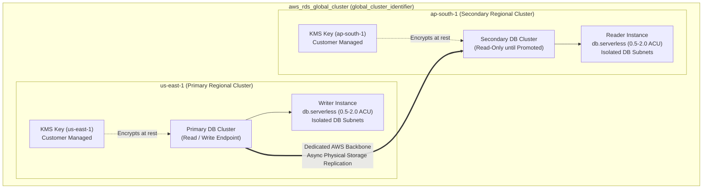

# Database Architecture & Operational Specification (`DATABASE.md`)

**Sources of Truth:** [PRD.md](file:///c:/Users/arif3/OneDrive/Attachments/Desktop/MultiRegioHighAvalabilityUsingAWS/PRD.md), [ARCHITECTURE.md](file:///c:/Users/arif3/OneDrive/Attachments/Desktop/MultiRegioHighAvalabilityUsingAWS/ARCHITECTURE.md)  
**Engine:** Amazon Aurora Global Database (Aurora PostgreSQL-Compatible Edition)

---

## 1. Engine, Version, and Instance Class Selection

### 1.1 Engine & Version Choice
- **Engine:** `aurora-postgresql`
- **Engine Version:** **PostgreSQL 16.4** (or latest AWS-supported 16.x LTS in both `us-east-1` and `ap-south-1`, verified via `aws rds describe-db-engine-versions --engine aurora-postgresql`).
- **Why Aurora PostgreSQL 16:** Native support for Aurora Global Database physical storage replication, fast managed switchover, and sub-second storage-level cross-region replication.

### 1.2 Instance Class Verification for Global Database
> **AWS Documentation Constraint:** Aurora Global Database **does not** support legacy burstable `db.t3` or `db.t4g.micro`/`small` instance classes across all engine versions. It supports **Memory-Optimized (`db.r6g`, `db.r7g`)** and **Aurora Serverless v2 (`db.serverless`)** on Aurora PostgreSQL 13.6+.

- **Chosen Instance Class:** `db.serverless` (**Aurora Serverless v2**) with scaling configuration:
  - `min_capacity = 0.5` ACU (~1 GB RAM)
  - `max_capacity = 2.0` ACU (~4 GB RAM)
- **Fallback Option (Configurable via `db_instance_class` variable):** `db.r6g.large` (2 vCPU, 16 GB RAM).
- **Why `db.serverless` (0.5 ACU min) is Optimal for This Project:**
  - At `0.5 ACU`, an instance costs **~$0.06/hour** (compared to ~$0.26/hour for `db.r6g.large`). Across 2 regions (1 writer in `us-east-1` + 1 reader in `ap-south-1`), this reduces database compute run-rate during test sessions by **~75%** (~$0.12/hr total instead of ~$0.52/hr) while retaining 100% compatibility with Aurora Global Database switchover and detach-and-promote.

---

## 2. Global Cluster Topology & Security Layout



### 2.1 Subnet Groups & Network Isolation
- **Primary DB Subnet Group:** `10.10.21.0/24` (`us-east-1a`), `10.10.22.0/24` (`us-east-1b`) — isolated subnets with **no route to IGW or NAT Gateway**.
- **Secondary DB Subnet Group:** `10.20.21.0/24` (`ap-south-1a`), `10.20.22.0/24` (`ap-south-1b`) — isolated subnets with **no route to IGW or NAT Gateway**.
- **Security Groups:** Port `5432/tcp` ingress allowed **exclusively** from the regional ECS Task Security Group (`sg-ecs-tasks`). `publicly_accessible = false`.

### 2.2 Encryption at Rest & In Transit
- **At Rest:** `storage_encrypted = true` on the `aws_rds_global_cluster` and both regional `aws_rds_cluster` resources.
  - Primary cluster uses `aws_kms_key.primary` (`us-east-1`).
  - Secondary cluster explicitly specifies `kms_key_id = aws_kms_key.secondary.arn` (`ap-south-1`) alongside `source_region = "us-east-1"`.
- **In Transit:** Parameter group forces `rds.force_ssl = 1` so all Node.js client connections use TLS.

---

## 3. Application Schema (Notes & RPO Write Tracker)

The schema is purposefully minimal and specifically engineered to support **both** functional CRUD verification and empirical **RPO measurement** during unplanned failover.

```sql
-- Migration 001: Notes & Monotonic Write Sequence Schema
CREATE TABLE IF NOT EXISTS notes (
    id              UUID PRIMARY KEY DEFAULT gen_random_uuid(),
    seq_no          BIGINT NOT NULL UNIQUE,
    title            VARCHAR(255) NOT NULL,
    content         TEXT NOT NULL,
    written_region  VARCHAR(32) NOT NULL,
    client_sent_at  TIMESTAMPTZ NOT NULL,
    db_committed_at TIMESTAMPTZ NOT NULL DEFAULT clock_timestamp()
);

-- Index for fast RPO audit queries (finding highest committed seq_no & recent writes)
CREATE INDEX IF NOT EXISTS idx_notes_seq_no_desc ON notes (seq_no DESC);
CREATE INDEX IF NOT EXISTS idx_notes_committed_at ON notes (db_committed_at DESC);
```

### Why `seq_no` Is a Client-Supplied `BIGINT UNIQUE` (Not Just `SERIAL`)
- During an RPO measurement test, our synthetic probe (`scripts/probe-rpo-rto.js`) increments `seq_no` (`1, 2, 3, ... N`) and records every `seq_no` that received an `HTTP 201 Created` acknowledgement from `us-east-1` prior to outage onset (`T0`).
- After promoting `ap-south-1`, we query:
  ```sql
  SELECT MAX(seq_no) AS max_recovered_seq, COUNT(*) AS total_rows FROM notes;
  ```
- **Empirical RPO (in writes lost):** `last_acknowledged_seq_in_primary - max_recovered_seq_in_secondary`.
- **Empirical RPO (in milliseconds):** Timestamp difference between the last acknowledged write in `us-east-1` and `db_committed_at` of `max_recovered_seq` in `ap-south-1`.

---

## 4. Replication Behavior, Lag Measurement & RPO Verification

1. **Physical Storage Replication:** When a transaction commits in `us-east-1`, Aurora writes log records to 6 storage nodes across 3 AZs in `us-east-1` and streams those log records asynchronously across the AWS backbone to the storage layer in `ap-south-1`.
2. **Expected Baseline Lag (`us-east-1` -> `ap-south-1`):**
   - Physical geographic distance between N. Virginia and Mumbai is ~12,000 km (~180–220 ms network RTT).
   - Consequently, `AuroraGlobalDBReplicationLag` published in CloudWatch (`ap-south-1`, `AWS/RDS` namespace) typically rests between **180 ms and 900 ms** under normal load.
3. **Never Claim a Guaranteed RPO:**
   - Because replication is asynchronous, RPO during an **unplanned** failover is bounded by the replication lag at the instant the primary storage stops transmitting.
   - We monitor `AuroraGlobalDBReplicationLag` with a 1-minute CloudWatch alarm threshold of `5,000 ms` (Warning) and `15,000 ms` (Critical).

---

## 5. Planned Switchover vs. Unplanned Failover (Detach & Promote)

Aurora Global Database supports two distinct recovery operations. Knowing the difference is critical:

| Characteristic | Planned Switchover (`switchover-global-cluster`) | Unplanned Failover (`failover-global-cluster --allow-data-loss` or Detach & Promote) |
| :--- | :--- | :--- |
| **When to Use** | Routine maintenance, DR drills where `us-east-1` is still reachable, or **Failback** from `ap-south-1` to `us-east-1`. | Catastrophic outage in `us-east-1` where the primary writer is unreachable/broken. |
| **RPO (Data Loss)** | **Zero (`RPO = 0`)** — AWS quieces writes on primary, waits for secondary to catch up 100%, then swaps roles. | **Non-Zero (`RPO ≈ current replication lag`)** — In-flight un-replicated log records are discarded. |
| **Topology After Action** | Global cluster remains intact! `ap-south-1` becomes Primary Writer; `us-east-1` automatically becomes Secondary Reader. | Depending on API mode: managed unplanned failover promotes `ap-south-1`, or `remove-from-global-cluster` detaches `ap-south-1` as an independent standalone cluster. |

### 5.1 Steps for Planned Switchover (`RPO = 0`)
```bash
aws rds switchover-global-cluster \
  --global-cluster-identifier "$GLOBAL_CLUSTER_ID" \
  --target-db-cluster-identifier "$SECONDARY_CLUSTER_ARN" \
  --region ap-south-1
```

### 5.2 Steps for Unplanned Failover (When Primary Region is Impaired)
**Option A — Managed Unplanned Failover (Preferred on Aurora PG 13.6+):**
```bash
aws rds failover-global-cluster \
  --global-cluster-identifier "$GLOBAL_CLUSTER_ID" \
  --target-db-cluster-identifier "$SECONDARY_CLUSTER_ARN" \
  --allow-data-loss \
  --region ap-south-1
```
**Option B — Manual Detach & Promote (Fallback if Global Control State is Locked):**
```bash
# 1. Detach ap-south-1 cluster from the global cluster (automatically promotes it to standalone Read/Write)
aws rds remove-from-global-cluster \
  --global-cluster-identifier "$GLOBAL_CLUSTER_ID" \
  --db-cluster-identifier "$SECONDARY_CLUSTER_ARN" \
  --region ap-south-1
```

---

## 6. Failback Approach (Returning to `us-east-1`)

After an unplanned failover where `ap-south-1` is now the active Writer:
1. **Case 1 (Managed `failover-global-cluster` or `switchover-global-cluster` was used):**
   - Wait for `us-east-1` to recover and sync as the secondary replica (`AuroraGlobalDBReplicationLag < 1000 ms`).
   - Run `switchover-global-cluster` targeting `us-east-1` (`RPO = 0` failback).
2. **Case 2 (Manual Detach `remove-from-global-cluster` was used):**
   - `ap-south-1` is now a standalone cluster with new writes that `us-east-1` does not have.
   - Our **AWS Step Functions Failback Workflow** performs:
     1. Delete/archive the stale `us-east-1` cluster and old global cluster container.
     2. Create a new global cluster identifier using `ap-south-1` as the source primary writer.
     3. Create a new headless replica cluster + instance in `us-east-1` attached to the global cluster.
     4. Poll until `us-east-1` status is `available` and `AuroraGlobalDBReplicationLag < 1000 ms`.
     5. Execute `switchover-global-cluster` to seamlessly hand primary writer role back to `us-east-1` with **zero data loss**.

---

## 7. Credentials Management via AWS Secrets Manager

- Master credentials (`username`, randomly generated 32-char `password`) are created in `us-east-1` inside an `aws_secretsmanager_secret` encrypted with `aws_kms_key.primary`.
- The secret is configured with a `replica` block pointing to `ap-south-1` encrypted with `aws_kms_key.secondary`.
- **Important Endpoint Distinction:** While the master `username` and `password` are identical across both clusters (because `ap-south-1` is physically replicated from `us-east-1`), the **Cluster Writer Endpoint hostname** is region-specific. Therefore:
  - ECS Task Definitions inject `DB_USER` and `DB_PASSWORD` from the **local region's Secrets Manager ARN**.
  - ECS Task Definitions inject `DB_HOST` from the **local region's Aurora Cluster Writer Endpoint (`aws_rds_cluster.this.endpoint`)**.
  - Wait—why pass `.endpoint` (the writer endpoint) in `ap-south-1` too? Because for an Aurora secondary cluster, once it is promoted to primary during failover, its `.endpoint` CNAME immediately resolves to the promoted writer instance without needing to redeploy the ECS Task Definition!

---

## 8. Backup, Retention, Recovery & Cost Notes

- **Backup Retention:** `backup_retention_period = 1` day in dev/test (minimizes backup storage charges after teardown); `7` to `35` days recommended for production.
- **Deletion Protection & Final Snapshot:**
  - `deletion_protection = false` and `skip_final_snapshot = true` in our test environment (`environments/dev/terraform.tfvars`) so `terraform destroy` completes cleanly after every session.
- **Safe Teardown Order (Critical Terraform Detail):**
  - Before destroying an Aurora Global Cluster, the secondary instance and secondary cluster in `ap-south-1` must be detached/destroyed first, followed by the primary instance and primary cluster in `us-east-1`, and finally the `aws_rds_global_cluster`. Terraform's dependency graph + our teardown script handles this automatically.
