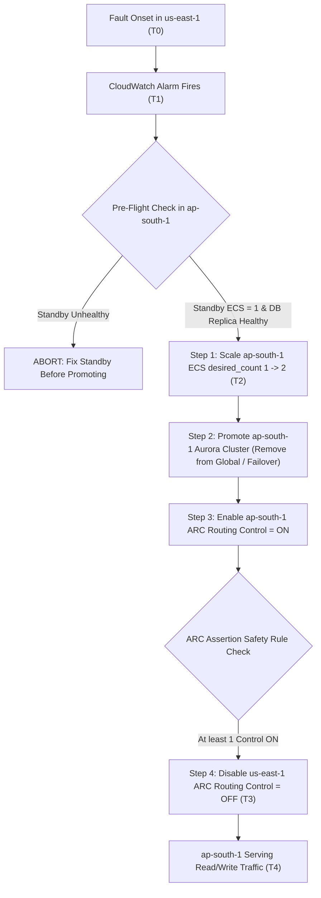

# Resilience Design & Operational Specification (`DESIGN.md`)

**Source of Truth:** [PRD.md](file:///c:/Users/arif3/OneDrive/Attachments/Desktop/MultiRegioHighAvalabilityUsingAWS/PRD.md)  
**Pattern:** Active-Passive Warm Standby (`us-east-1` Primary, `ap-south-1` Secondary)

---

## 1. Failure Modes Analysis

A credible resilience design must explicitly separate failure modes handled automatically within a region from catastrophic failures that require cross-region failover—and be honest about what is not covered.

### 1.1 Failure Modes Covered
| Failure Scope | Failure Scenario | Mitigation Mechanism | Cross-Region Failover Required? |
| :--- | :--- | :--- | :--- |
| **Single Container / Task** | Node.js process crash, OOM kill, or unhandled exception in `us-east-1`. | ALB Target Group health check (`GET /health/deep`) drains target; ECS Service scheduler launches replacement Fargate task. | **No** (Handled locally in < 45s). |
| **Single Availability Zone (AZ)** | Loss of power, networking, or compute in `us-east-1a`. | ALB routes exclusively to `us-east-1b` Fargate task; Aurora storage is 6-way replicated across 3 AZs and promotes/retains writer availability. | **No** (Handled locally by Multi-AZ). |
| **Regional Compute / Database Impairment** | Multi-AZ ECS deployment failure, regional VPC/NAT degradation, or Aurora writer corruption/unreachability in `us-east-1`. | CloudWatch Alarms fire (`PrimaryDeepHealthAlarm`, `ALB5xxAlarm`). Operator triggers **Region Switch Plan** (Aurora unplanned promotion + Route 53 ARC routing control flip). | **Yes** (Full regional failover to `ap-south-1`). |
| **Regional Static Asset Origin Outage** | S3 service impairment in `us-east-1`. | CloudFront Origin Group automatically retries failed `GET`/`HEAD` requests (`500, 502, 503, 504`) against the replicated `ap-south-1` S3 bucket. | **Automatic at Edge** (Zero operator intervention). |

### 1.2 What Is Explicitly NOT Covered (Honest Boundaries)
1. **True AWS Global Control-Plane Collapse via FIS:** AWS Fault Injection Service (FIS) injects component-level faults (terminating tasks, blackholing subnet traffic via NACLs, rebooting DB instances). It **cannot** simulate a genuine AWS regional infrastructure blackout or loss of the `us-east-1` IAM/STS global control plane.
2. **Logical Data Corruption / Accidental `DROP TABLE`:** Aurora Global Database replicates storage blocks within < 1s. A malicious or accidental `DELETE FROM notes;` in `us-east-1` replicates immediately to `ap-south-1`. Recovery from logical corruption requires Aurora Point-in-Time Recovery (PITR) or AWS Backup, not regional failover.
3. **Zero-RPO on Unplanned Outage:** Because physical storage replication from N. Virginia (`us-east-1`) to Mumbai (`ap-south-1`) is asynchronous (~180–220 ms speed-of-light RTT), unplanned detach-and-promote can lose in-flight transactions committed within the final replication lag window (~0.2s–2.0s).

---

## 2. Failover Decision Flow & Safety Rules

### 2.1 Why Human-Triggered / Guarded Failover Over Automatic DNS Flip?
Unplanned database failover (`Detach and Promote` on Aurora Global Database) severing the replication link is a **destructive, one-way action** that incurs non-zero RPO and requires a multi-step rebuild to fail back. Triggering an unplanned database promotion automatically on a transient 30-second network blip causes more downtime than it prevents. Therefore:
- **Detection is automated** (CloudWatch alarms + synthetic probe).
- **Decision is human-authorized** (or executed via an explicit Region Switch Plan invocation), guarded by **ARC Safety Rules**.

### 2.2 Detection Signals
Failover is declared when **two or more** of the following signals persist for `>= 2 consecutive evaluation periods (120 seconds)`:
1. `us-east-1-alb-unhealthy-hosts`: HealthyHostCount on primary ALB drops to `0`.
2. `us-east-1-alb-5xx-rate`: HTTP 5xx error rate exceeds `10%`.
3. `external-probe-deep-health`: External probe targeting `GET /health/deep` in `us-east-1` fails consecutively while `ap-south-1` `GET /health` reports healthy and `AuroraGlobalDBReplicationLag` was `< 5,000 ms` prior to loss of signal.

### 2.3 Failover Sequence & Safety Rules

### 2.4 Route 53 ARC Safety Rule (Anti-Blackhole Rule)
- **Rule Type:** Assertion Rule (`ATLEAST 1`)
- **Target Controls:** `[rc-primary-us-east-1, rc-secondary-ap-south-1]`
- **Enforcement:** The ARC data plane rejects any API call that attempts to set `rc-primary-us-east-1 = OFF` before `rc-secondary-ap-south-1 = ON` has been confirmed. Consequently, traffic **Always** transitions in a **Make-Before-Break** sequence (`[ON, OFF] -> [ON, ON] -> [OFF, ON]`).

---

## 3. Architecture Diagram Conventions

All architecture diagrams in `ARCHITECTURE.md`, `README.md`, and presentation slides must strictly adhere to the following visual language:

| Element | Visual Convention | Meaning |
| :--- | :--- | :--- |
| **Normal Traffic Path** | **Solid Green/Dark Arrow (`--->`)** | Active read/write requests flowing through `us-east-1` ALB -> ECS -> Aurora Writer, and async replication to `ap-south-1`. |
| **Failover Traffic Path** | **Dashed Orange/Red Arrow (`-.->`)** | Standby traffic path activated only when ARC switches `ap-south-1` routing control to `ON` and promotes Aurora Replica to Writer. |
| **Control / Orchestration Path** | **Dotted Blue Arrow (`..->`)** | AWS FIS fault injection, Step Functions failback calls, or operator CLI commands to ARC cluster endpoints. |
| **Primary Region Box** | `#E8F5E9` (Light Green border) | `us-east-1` (Active Primary in normal state). |
| **Secondary Region Box** | `#FFF3E0` (Light Amber border) | `ap-south-1` (Warm Standby in normal state, Active in failover state). |

---

## 4. Observability & Dashboard Design

Two identical regional dashboards (`HA-Dashboard-us-east-1` and `HA-Dashboard-ap-south-1`) plus a cross-region summary view are provisioned so operators retain visibility even if the `us-east-1` CloudWatch console is degraded.

| Widget / Metric | Namespace | Healthy Baseline (`us-east-1` / `ap-south-1`) | Failing / Alert State |
| :--- | :--- | :--- | :--- |
| **ALB Healthy Host Count** | `AWS/ApplicationELB` (`HealthyHostCount`) | Primary: `2` \| Secondary: `1` | Primary drops to `< 1` |
| **ALB HTTP 5xx Count & Target Response Time** | `AWS/ApplicationELB` (`HTTPCode_Target_5XX_Count`, `TargetResponseTime`) | `0` errors; p95 latency `< 50 ms` | `> 5` errors/min or p95 `> 2,000 ms` |
| **ECS CPU & Memory Utilization** | `AWS/ECS` (`CPUUtilization`, `MemoryUtilization`) | `10% – 60%` | `> 85%` sustained or `0` running tasks |
| **Aurora Global Replication Lag** | `AWS/RDS` (`AuroraGlobalDBReplicationLag` in `ap-south-1`) | `180 ms – 1,000 ms` (US to India baseline) | `> 5,000 ms` (Warning) / `> 15,000 ms` (Critical RPO risk) |
| **Aurora Global Replicated Write IOPS & Connections** | `AWS/RDS` (`AuroraGlobalDBReplicatedWriteIO`, `DatabaseConnections`) | Active replication > 0; connections stable | Sudden drop to `0` during active workload |
| **S3 Replication Latency** | `AWS/S3` (`ReplicationLatency`) | `< 900 seconds` | `> 900 seconds` or `OperationsFailedReplication > 0` |

---

## 5. Runbook & Failback Documentation Structure

Both `RUNBOOK.md` (Unplanned Failover) and `FAILBACK.md` (Planned Return to Primary) must follow a deterministic, copy-pasteable structure:

1. **Metadata Block:** Target RTO, Expected RPO, Required IAM Role, Required CLI Tools (`aws`, `jq`, `curl`).
2. **Preconditions Checklist:** Explicit commands to verify before acting (e.g., verify `ap-south-1` `/health` returns `200`, check `AuroraGlobalDBReplicationLag`, confirm 5 ARC cluster endpoints are reachable).
3. **Numbered Execution Steps:**
   - Exact CLI command using environment variables (`$ARC_CLUSTER_ENDPOINT`, `$SECONDARY_CLUSTER_ID`).
   - **Expected Output** snippet so the operator knows immediately if the command succeeded.
   - **Expected Timing** (e.g., *"Expected Duration: 45–90 seconds"*).
   - **Timestamp Capture Hook** (`date -u +"%Y-%m-%dT%H:%M:%S.%3NZ"`) for RTO calculation.
4. **Verification Gate:** Commands confirming `X-Served-By-Region: ap-south-1` and successful `POST /notes` database write.
5. **Rollback / Abort Procedure:** What to do if promotion or traffic shifting fails midway.

---

## 6. Documentation Standards for `README.md` and Demo Video

### 6.1 `README.md` Standards
- **Lead with Evidence:** Top section must display the architecture diagram (solid vs. dashed paths), the measured `[Min, Median, Max]` RTO/RPO summary table from 3 actual runs, and the actual AWS Cost Explorer breakdown.
- **No Unbacked Claims:** Every resilience or cost figure must link to a log file in `evidence/` or state *"Estimate — not measured"*.
- **Teardown Warning Banner:** Prominent instructions at the top of the Deployment section reminding readers of the `$2.50/hr` ARC Cluster cost and the `make destroy` verification script.
- **Attribution:** Dedicated section crediting any official AWS samples or Terraform reference architectures consulted.

### 6.2 Demo Video (2 to 3 Minutes) Standards
- **0:00 – 0:30 (Normal State):** Show terminal probe hitting the endpoint every second (`X-Served-By-Region: us-east-1`, `seq_no` incrementing) alongside the Architecture diagram.
- **0:30 – 1:10 (Fault Injection & Detection):** Start AWS FIS experiment in `us-east-1`; show probe returning errors (`T0`) and CloudWatch Alarm transitioning to `ALARM` (`T1`).
- **1:10 – 2:10 (Failover Execution):** Run failover script/runbook (`T2`): promote `ap-south-1` Aurora cluster and flip ARC Routing Control using the data-plane endpoint (`T3`). Show probe automatically recovering with `X-Served-By-Region: ap-south-1` (`T4`).
- **2:10 – 2:45 (RTO/RPO Calculation & Failback):** Show the script output calculating exact RTO (`T4 - T0`) and RPO (`missing seq_no count = 0 or N`), plus the Step Functions failback execution graph.
