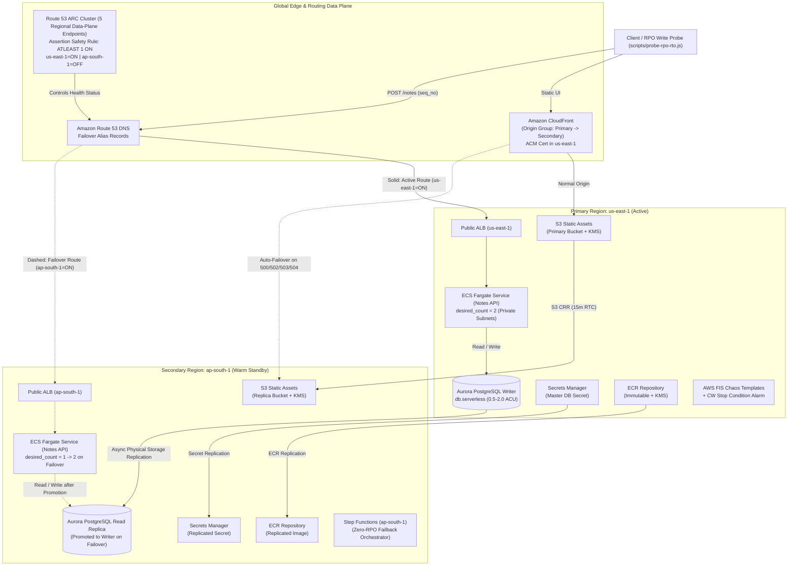

# Multi-Region High Availability & Disaster Recovery on AWS

**Architecture Pattern:** Active-Passive Warm Standby (`us-east-1` Primary -> `ap-south-1` Secondary)  
**Stack:** Terraform (Reusable Multi-Region Modules) | ECS Fargate + ALB | Aurora Global PostgreSQL Serverless v2 | Route 53 Application Recovery Controller (ARC) | S3 CRR + CloudFront Origin Group | AWS FIS Chaos Engineering | AWS Step Functions Failback

> [!CAUTION]
> **Cost & Ephemeral Teardown Guardrail:**  
> - A **Route 53 ARC Cluster** costs **$2.50 / hour** (~$1,825/month if left running!). It is gated behind `enable_arc_cluster = false` by default in [environments/dev/terraform.tfvars](file:///c:/Users/arif3/OneDrive/Attachments/Desktop/MultiRegioHighAvalabilityUsingAWS/environments/dev/terraform.tfvars).  
> - Always run `make destroy && make verify-teardown` ([scripts/verify-clean-teardown.sh](file:///c:/Users/arif3/OneDrive/Attachments/Desktop/MultiRegioHighAvalabilityUsingAWS/scripts/verify-clean-teardown.sh)) immediately after every live AWS test session to confirm **$0.00/hr** residual run rate.

---

## 1. What This Project Solves & Proves

Many multi-region cloud projects claim *"zero downtime"* or *"sub-second RPO"* without measuring actual data loss or testing whether their failover mechanism works during a control-plane impairment. This project demonstrates production-grade disaster recovery engineering:

1. **Data-Plane-First Routing with Route 53 ARC:** Instead of relying on standard Route 53 control-plane health checks (hosted in `us-east-1`), traffic shifting uses **Route 53 Application Recovery Controller (ARC)** across 5 globally distributed data-plane cluster endpoints guarded by an **Assertion Safety Rule (`ATLEAST 1 ON`)** so both regions can never be turned off simultaneously.
2. **Stateful Cross-Continental Persistence (`us-east-1` -> `ap-south-1`):** Uses **Aurora Global Database (PostgreSQL 16 Serverless v2, `0.5–2.0 ACU`)** with dedicated regional customer-managed KMS keys and cross-region **Secrets Manager** & **ECR** replication.
3. **Zero-Container-Restart Database Promotion:** The Node.js (Fastify) API exposes both a shallow `/health` liveness endpoint and a deep `/health/deep` readiness endpoint (`SELECT pg_is_in_recovery()`), and automatically evicts stale read-only TCP sockets (`SQLSTATE 25006`) when the warm standby replica in `ap-south-1` is promoted to writer.
4. **Controlled Chaos & Automated Zero-RPO Failback:** Fault injection via **AWS FIS** is bound to mandatory CloudWatch Stop Condition alarms, while failback to `us-east-1` is orchestrated by an **AWS Step Functions** state machine hosted in `ap-south-1` executing a zero-data-loss (`RPO = 0`) managed Global Cluster switchover.

---

## 2. Multi-Region Architecture Diagram

- **Solid Arrows (`--->`)**: **Normal Operation Path** (`us-east-1` active read/write; asynchronous replication to `ap-south-1` warm standby running `desired_count = 1`).
- **Dashed Arrows (`-.->`)**: **Failover Operation Path** (Activated when `ap-south-1` Aurora Replica is promoted to Writer and Route 53 ARC switches `ap-south-1` to `ON`).



---

## 3. RTO & RPO Measurement Methodology & Results Table

### 3.1 How RTO and RPO Are Measured ([scripts/probe-rpo-rto.js](file:///c:/Users/arif3/OneDrive/Attachments/Desktop/MultiRegioHighAvalabilityUsingAWS/scripts/probe-rpo-rto.js))
- **Continuous Write Probe:** Sends `POST /notes` with a client-supplied monotonic sequence counter (`seq_no: 1, 2, 3...`) every `500 ms` (2 writes/sec).
- **RTO Formula:** $\text{RTO} = T_4 - T_0$, where $T_0$ is the UTC timestamp of the first failed write in `us-east-1` upon fault injection, and $T_4$ is the UTC timestamp of the first `HTTP 201 Created` response served by `ap-south-1` (`X-Served-By-Region: ap-south-1`).
- **RPO Formula:** $\text{RPO (lost writes)} = \text{Last Acknowledged } \texttt{seq\_no} \text{ in } \texttt{us-east-1} - \max(\texttt{seq\_no}) \text{ recovered in } \texttt{ap-south-1}$.

### 3.2 Target Hypotheses vs. Measured Trials Summary

> **Note:** Target figures are engineering hypotheses based on `us-east-1` -> `ap-south-1` (~190 ms physical RTT). Run `bash scripts/failover-drill.sh 1..3` during your Phase 9 live AWS session to populate the measured trial columns from `evidence/trial-*.json`.

| Metric | Target Hypothesis | Trial 1 (`evidence/trial-1.json`) | Trial 2 (`evidence/trial-2.json`) | Trial 3 (`evidence/trial-3.json`) | Summary `[Min, Median, Max]` |
| :--- | :---: | :---: | :---: | :---: | :---: |
| **Baseline `AuroraGlobalDBReplicationLag`** | `180 – 900 ms` | *Pending Live Run* | *Pending Live Run* | *Pending Live Run* | *Pending Live Run* |
| **Unplanned Failover RTO (`T4 - T0`)** | `< 180 seconds` | *Pending Live Run* | *Pending Live Run* | *Pending Live Run* | *Pending Live Run* |
| **Unplanned Failover RPO (Lost Writes)** | `< 2 seconds` (`0–4` writes) | *Pending Live Run* | *Pending Live Run* | *Pending Live Run* | *Pending Live Run* |
| **Planned Failback RPO (Step Functions Switchover)** | **`0 seconds` (`0` writes lost)** | *Pending Live Run* | *Pending Live Run* | *Pending Live Run* | *Pending Live Run* |

### 3.3 Honest Architectural Limitations
1. **AWS FIS Scope:** AWS Fault Injection Service simulates component and AZ failures inside `us-east-1` (e.g., terminating all ECS tasks or rebooting Aurora instances). It **cannot** simulate a true AWS regional control-plane collapse.
2. **Speed-of-Light Floor:** Because N. Virginia (`us-east-1`) and Mumbai (`ap-south-1`) are ~12,000 km apart (~190 ms network RTT), asynchronous physical storage replication cannot achieve `RPO = 0` on an **unplanned** sudden severing of `us-east-1`. Zero RPO is guaranteed only during **planned** `switchover-global-cluster` operations.

---

## 4. Cost Summary & Ephemeral Testing Discipline

Full itemized pricing and Cost Explorer tracking are documented in **[COST.md](file:///c:/Users/arif3/OneDrive/Attachments/Desktop/MultiRegioHighAvalabilityUsingAWS/COST.md)**:

- **Core Warm-Standby Stack (Phases 1–5 & 7–8, `enable_arc_cluster = false`):** **~$0.33 / hour** (~$239/month 24/7 equivalent — a **~1.45x** multiplier over a single-region baseline of ~$165/month).
- **Route 53 ARC Cluster (`enable_arc_cluster = true` during Phase 6 & 9):** **+$2.50 / hour** flat fee.
- **Total 4-Hour Guided Test Lab Cost (Across 3 Ephemeral Sessions):** **~$4.92 USD** total when destroyed after each session.

---

## 5. Repository Documentation Map

| Document | Purpose |
| :--- | :--- |
| **[PRD.md](file:///c:/Users/arif3/OneDrive/Attachments/Desktop/MultiRegioHighAvalabilityUsingAWS/PRD.md)** | Product requirements, target RTO/RPO hypotheses, functional & non-functional requirements, approved decisions. |
| **[DESIGN.md](file:///c:/Users/arif3/OneDrive/Attachments/Desktop/MultiRegioHighAvalabilityUsingAWS/DESIGN.md)** | Failure mode analysis, Make-Before-Break ARC failover decision flow, diagram conventions, dashboard design. |
| **[ARCHITECTURE.md](file:///c:/Users/arif3/OneDrive/Attachments/Desktop/MultiRegioHighAvalabilityUsingAWS/ARCHITECTURE.md)** | Layer-by-layer justification, control-plane vs. data-plane dependency matrix, VPC subnet design (`10.10.0.0/16` & `10.20.0.0/16`). |
| **[DATABASE.md](file:///c:/Users/arif3/OneDrive/Attachments/Desktop/MultiRegioHighAvalabilityUsingAWS/DATABASE.md)** | Aurora Global PostgreSQL 16 Serverless v2 topology, schema (`seq_no`), planned switchover vs. unplanned failover. |
| **[API.md](file:///c:/Users/arif3/OneDrive/Attachments/Desktop/MultiRegioHighAvalabilityUsingAWS/API.md)** | Fastify REST API contract (`/health`, `/health/deep`, `POST /notes`, `GET /notes`), `SQLSTATE 25006` connection pool recovery. |
| **[AGENTS.md](file:///c:/Users/arif3/OneDrive/Attachments/Desktop/MultiRegioHighAvalabilityUsingAWS/AGENTS.md)** | Strict Terraform & security guardrails (zero hardcoded regions, single-module reuse, KMS encryption, least-privilege IAM). |
| **[PLAN.md](file:///c:/Users/arif3/OneDrive/Attachments/Desktop/MultiRegioHighAvalabilityUsingAWS/PLAN.md)** | 10-phase incremental implementation roadmap with hourly cost exposure per phase. |
| **[RUNBOOK.md](file:///c:/Users/arif3/OneDrive/Attachments/Desktop/MultiRegioHighAvalabilityUsingAWS/RUNBOOK.md)** | Copy-paste operator runbook for Unplanned Regional Failover (`us-east-1` -> `ap-south-1`). |
| **[FAILBACK.md](file:///c:/Users/arif3/OneDrive/Attachments/Desktop/MultiRegioHighAvalabilityUsingAWS/FAILBACK.md)** | Copy-paste operator runbook for Planned Zero-RPO Failback via AWS Step Functions (`ap-south-1` -> `us-east-1`). |
| **[COST.md](file:///c:/Users/arif3/OneDrive/Attachments/Desktop/MultiRegioHighAvalabilityUsingAWS/COST.md)** | Itemized hourly & monthly cost analysis, Warm Standby vs. Active-Active comparison, and Cost Explorer session ledger. |
| **[DEMO_SCRIPT.md](file:///c:/Users/arif3/OneDrive/Attachments/Desktop/MultiRegioHighAvalabilityUsingAWS/DEMO_SCRIPT.md)** | 2-to-3 minute portfolio demo recording script and screen layout guide. |

---

## 6. Step-by-Step Reproduction Guide

### 6.1 Run Local Unit Tests & Static Verification ($0.00 Cost)
```bash
# 1. Run Node.js Fastify API unit tests (shallow/deep health, RPO seq_no, SQLSTATE 25006 replica handling)
cd app && npm install && npm test && cd ..

# 2. Format and validate both bootstrap/ and root multi-region Terraform stacks
make fmt
make validate
```

### 6.2 Phase 1: Bootstrap Remote State & AWS Budget Guardrail
```bash
terraform -chdir=bootstrap init
terraform -chdir=bootstrap plan -var="budget_alert_email=your-email@example.com"
# Review plan, then apply with explicit confirmation:
terraform -chdir=bootstrap apply -var="budget_alert_email=your-email@example.com"
```

### 6.3 Incremental Phased Deployment (`environments/dev/terraform.tfvars`)
Toggle the feature flags in [environments/dev/terraform.tfvars](file:///c:/Users/arif3/OneDrive/Attachments/Desktop/MultiRegioHighAvalabilityUsingAWS/environments/dev/terraform.tfvars) as you progress through [PLAN.md](file:///c:/Users/arif3/OneDrive/Attachments/Desktop/MultiRegioHighAvalabilityUsingAWS/PLAN.md):
```bash
# Always review the execution plan before applying:
make plan
make apply
```

### 6.4 Mandatory Post-Session Teardown & Zero-Cost Audit
```bash
make destroy
make verify-teardown
```

---

## 7. Interview Talking Points

1. **"Why Route 53 ARC instead of standard Route 53 DNS Health Checks?"**
   - Standard Route 53 health check configuration and control-plane updates depend on `us-east-1`. Route 53 ARC provides **5 regional data-plane endpoints** running Raft consensus, allowing us to flip traffic on the data plane even during a `us-east-1` control-plane impairment, while enforcing a Make-Before-Break **Assertion Safety Rule (`ATLEAST 1 ON`)**.
2. **"Why did you separate `/health` (shallow) and `/health/deep`?"**
   - ECS container health checks hit `/health` (shallow) so a database failover doesn't trick ECS into killing and restarting healthy Node.js containers in a crash loop. The ALB Target Group and our failover probe hit `/health/deep` (`SELECT pg_is_in_recovery()`), which reports `"db_role": "writer"` in `us-east-1` and `"db_role": "replica"` in `ap-south-1`.
3. **"How does the warm standby app transition from read-only replica to writer without restarting containers?"**
   - Both regions point `DB_HOST` at their local Aurora Cluster Writer Endpoint (`.endpoint`). When `ap-south-1` Aurora is promoted, its cluster endpoint CNAME resolves to the newly promoted writer instance, and our Node.js `pg.Pool` automatically evicts any cached read-only TCP socket upon catching `SQLSTATE 25006` (`client.release(true)`).
4. **"What would you change for enterprise production?"**
   - Switch `single_nat_gateway` from `true` to `false` (1 NAT GW per AZ), increase Aurora Serverless v2 `min_capacity` from `0.5 ACU` to `2.0+ ACU`, add AWS WAF in front of CloudFront and regional ALBs, and enable `deletion_protection = true` on Aurora and ALBs.

---

## 8. Credits & Reference Attributions

This project's architecture and patterns were informed by the following official AWS documentation and open-source patterns (all Terraform modules and application code in this repository were authored from scratch for this project):
- **AWS Disaster Recovery Whitepaper:** *Disaster Recovery of Workloads on AWS: Recovery in the Cloud (Warm Standby Pattern)*.
- **Amazon Route 53 Application Recovery Controller Developer Guide:** *Routing control safety rules and 5-region data-plane cluster endpoints*.
- **Amazon Aurora User Guide:** *Using Amazon Aurora Global Database (Switchover vs. Unplanned Failover & Serverless v2 configuration)*.
- **AWS Fault Injection Service User Guide:** *Experiment templates and CloudWatch alarm stop conditions*.
